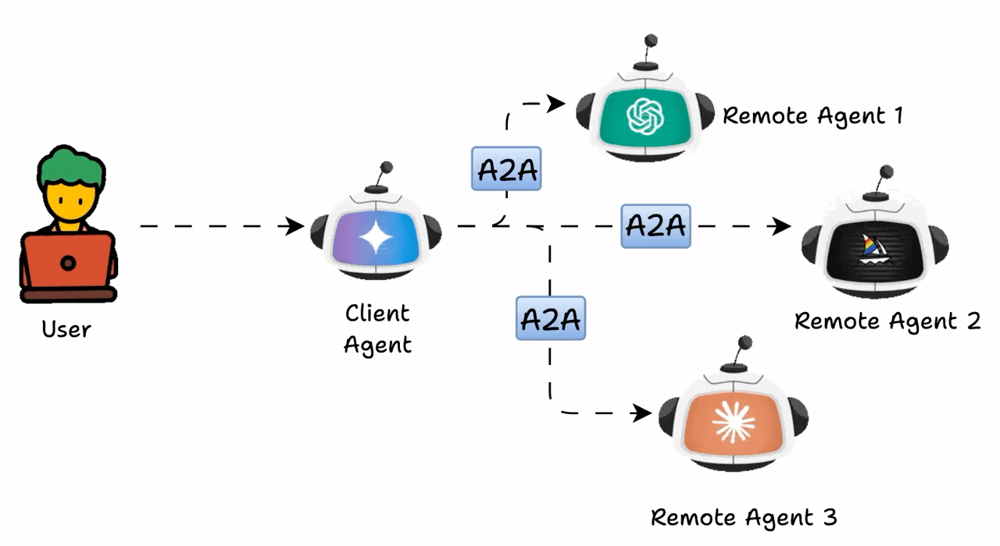
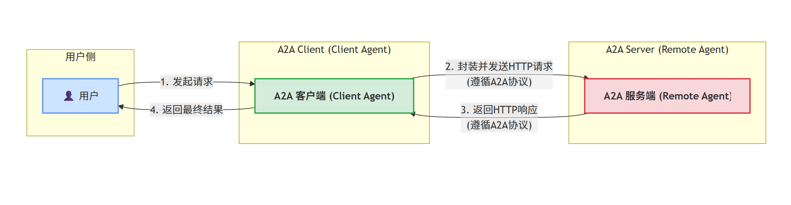
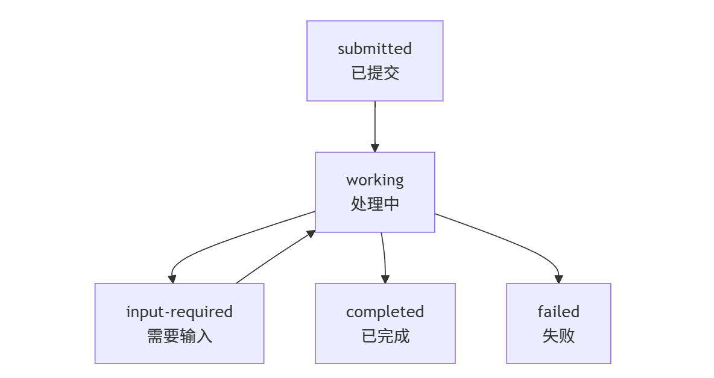
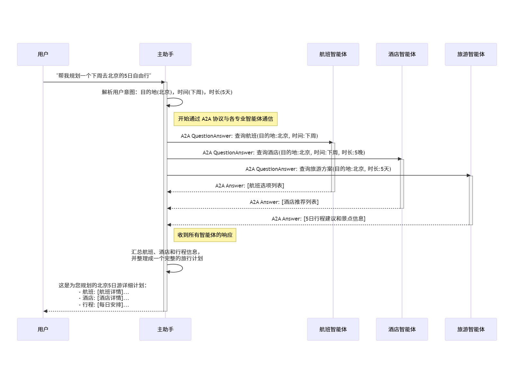
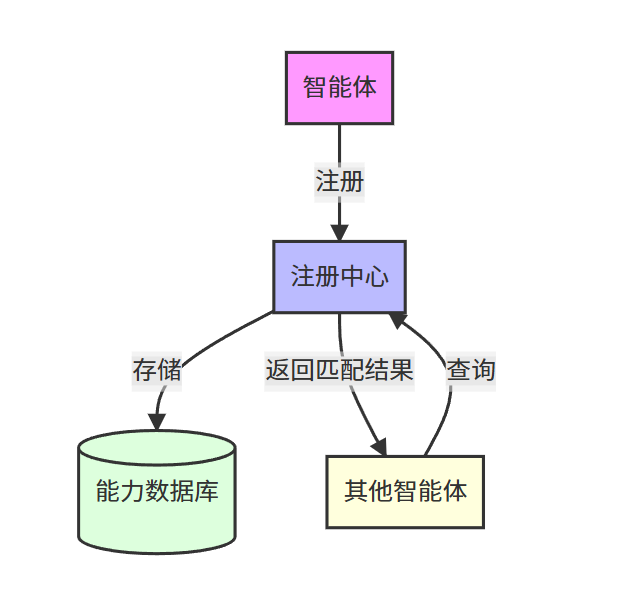

# A2A 协议

## 目标

A2A 是 Agent2Agent 协议，用于标准化 Agent 之间的通信。它允许不同框架、语言、平台构建的 Agent 互相协作，而不需要暴露内部状态、内存或私有工具实现。

当系统中只有一个 Agent 时，工具调用和本地编排基本够用；当多个团队、多个系统、多个 Agent 都需要协作时，就需要一个跨框架的通信协议。A2A 关注的不是“模型怎么推理”，而是“一个 Agent 如何发现另一个 Agent、如何发起任务、如何接收状态和结果”。



## 1. 角色

### A2A Client

也叫 Client Agent，通常直接面向用户。它接收用户请求，并决定是否需要调用远程 Agent。

### A2A Server

也叫 Remote Agent，接收 A2A Client 的请求，执行任务并返回结果。

通信方式通常基于 HTTP，服务端接口需要符合 A2A 协议定义。



```text
用户
  -> A2A Client
  -> A2A Server / Remote Agent
  -> 返回任务状态、消息或产物
```

## 2. 基础通信元素

### Agent Card

Agent Card 是智能体名片，通常是 JSON 元数据文档。它描述 A2A Server 的能力、地址、认证方式和技能列表。

常见地址：

```text
/.well-known/agent.json
```

核心信息：

- Agent 名称和描述。
- 服务端点 URL 和版本。
- 支持的能力，例如 streaming、pushNotifications。
- 认证要求。
- 技能列表。
- 默认输入和输出模式。

简化示例：

```json
{
  "name": "智能旅行助手",
  "description": "专业的旅行规划和预订服务",
  "url": "https://api.travelagent.com/a2a",
  "version": "1.0.0",
  "capabilities": {
    "streaming": true,
    "pushNotifications": true
  },
  "skills": [
    {
      "id": "flight-booking",
      "name": "航班预订",
      "inputModes": ["text", "data"],
      "outputModes": ["text", "data"]
    }
  ]
}
```

### Task

Task 表示一次端到端任务，负责跟踪特定目标的完整生命周期。



常见状态：

| 状态 | 含义 |
| --- | --- |
| `submitted` | 已提交，服务端已收到 |
| `working` | 正在处理 |
| `input-required` | 需要客户端补充输入 |
| `completed` | 已完成 |
| `canceled` | 已取消 |
| `failed` | 执行失败 |
| `rejected` | 被远程 Agent 拒绝 |
| `auth-required` | 需要认证 |
| `unknown` | 状态未知 |

任务特征：

- 每个任务有唯一 ID。
- 任务是有状态的。
- 多个任务可以归属同一个会话或上下文。
- 可支持持续交互，例如“画风筝 -> 改成红色 -> 改成黑色”。

### Message

Message 表示一次通信消息。

核心字段：

- `role`：`user` 或 `agent`。
- `parts`：消息内容片段，至少一个。
- `metadata`：附加信息。
- `messageId`：消息 ID。
- `taskId`：关联任务 ID。
- `contextId`：关联上下文 ID。

### Part

Part 是 Message 的组成片段，支持多模态内容。

类型：

- `text`：文本。
- `file`：文件。
- `data`：结构化数据。

### Artifact

Artifact 是任务生成的输出或中间产物。

例如：

- 文本报告。
- 图片文件。
- 表格数据。
- 流式生成的中间结果。

## 3. 交互机制

A2A 通信不是简单的一问一答，而是围绕 Task 生命周期展开。

A2A 支持多种交互模式：

| 机制 | 适用场景 | 技术实现 | 特点 |
| --- | --- | --- | --- |
| 请求/响应 | 简单查询、短任务 | HTTP 请求和轮询 | 简单，实时性一般 |
| 流式传输 | 实时更新、增量结果 | Server-Sent Events | 实时性好，需要保持连接 |
| 推送通知 | 长任务、异步处理 | Webhook 回调 | 适合异步任务，实现更复杂 |



典型过程：

```text
Client 发现 Agent Card
  -> 根据技能和认证信息选择 Remote Agent
  -> 创建或发送 Task / Message
  -> Server 返回任务状态
  -> Client 轮询、订阅或接收流式更新
  -> Server 返回 Message / Artifact / 状态变化
```

## 4. 能力发现机制

能力发现是 A2A 的关键：Client 不能预先写死所有 Remote Agent 的能力，而是要先读取 Agent Card，再根据任务需求匹配合适的 Agent。

典型匹配过程：

```text
读取 Agent Card
  -> 查看 skills / functions
  -> 对比输入输出 schema、标签、业务领域
  -> 选择可处理任务的 Remote Agent
  -> 发起 A2A 调用
```



### Well-Known URI

服务端在固定路径暴露 Agent Card。

```text
https://example.com/.well-known/agent.json
```

### 目录式发现

通过集中目录维护多个 Agent 的元数据，Client 根据需求搜索或筛选。

### 私有发现

在企业内部系统、配置中心、服务注册中心中维护 Agent 信息，适合需要鉴权和内网隔离的场景。

## 5. Eino A2A 服务端骨架

```go
h := server.Default()

registrar, err := jsonrpc.NewRegistrar(ctx, &jsonrpc.ServerConfig{
    Router:      h,
    HandlerPath: "/a2a",
})

chatModel, err := ollama.NewChatModel(ctx, &ollama.ChatModelConfig{
    BaseURL: "http://localhost:11434",
    Model:   "modelscope.cn/Qwen/Qwen3-32B-GGUF:latest",
})

agent, err := adk.NewChatModelAgent(ctx, &adk.ChatModelAgentConfig{
    Name:        "book-recommender",
    Description: "A book recommender agent",
    Instruction: "根据用户给定书名推荐相似书籍。",
    Model:       chatModel,
})

err = registrar.Register(agent)
h.Spin()
```

## 6. Eino A2A 客户端骨架

```go
transport, err := jsonrpc.NewTransport(ctx, &jsonrpc.ClientConfig{
    BaseURL:     "http://127.0.0.1:8888",
    HandlerPath: "/a2a",
})

a2aClient, err := client.NewA2AClient(ctx, &client.Config{
    Transport: transport,
})

streaming := true
remoteAgent, err := eino.NewAgent(ctx, eino.AgentConfig{
    Client:    a2aClient,
    Streaming: &streaming,
})

runner := adk.NewRunner(ctx, adk.RunnerConfig{
    Agent:           remoteAgent,
    EnableStreaming: true,
})

run := runner.Run(ctx, []adk.Message{
    schema.UserMessage("recommend a fiction book to me"),
})

for {
    event, ok := run.Next()
    if !ok {
        break
    }
    fmt.Println(event.Output.MessageOutput.Message.Content)
}
```

## 记忆点

- Agent Card 负责“我是谁、我在哪、我会什么、怎么调用我”。
- Task 负责跟踪一次任务生命周期。
- Message 负责表达通信内容。
- Part 让消息支持多模态。
- Artifact 表示任务输出或中间产物。
- A2A 解决的是 Agent 之间跨框架、跨服务通信的问题。
